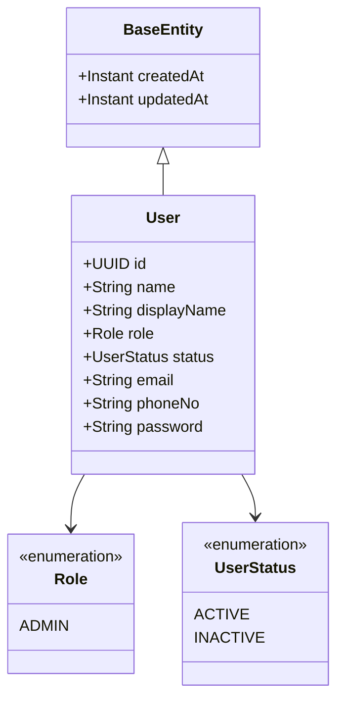
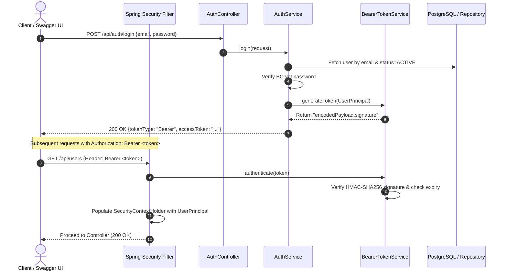

# Sagasia CRM Backend — Architecture & Features Documentation

## 1. Executive Summary

This project is a stateless, production-grade Spring Boot backend for an internal Customer Relationship Management (CRM) platform. It provides enterprise security, internal user management (CRUD), HMAC-SHA256 signed Bearer token authentication, PostgreSQL persistence, and interactive OpenAPI 3 (Swagger UI) documentation.

Unit and integration tests run entirely in an isolated in-memory H2 database, requiring no running external database or Docker containers.

---

## 2. Technology Stack

| Layer | Component | Version / Description |
|---|---|---|
| **Language** | Java | 21 LTS |
| **Framework** | Spring Boot | 4.1.1 (Spring Framework 7.x) |
| **Security** | Spring Security | 7.x (Stateless Bearer Filter Chain) |
| **Persistence** | Spring Data JPA / Hibernate | 7.4.x |
| **Primary Database** | PostgreSQL | 16 (Configurable via `.env`) |
| **Test Database** | H2 Database | 2.4.x (In-memory, `mem:sagasia_test`) |
| **Documentation** | SpringDoc OpenAPI | 3.1.0 (Swagger UI & OpenAPI v3) |
| **Boilerplate Reduction** | Project Lombok | Managed via compiler annotation processor |
| **Environment Management** | `me.paulschwarz:spring-dotenv` | 4.0.0 (Loads `.env` into Spring Environment) |

---

## 3. Data Model & User Entity

The internal CRM user model represents authenticated internal team members and administrators.

### Entity Attributes



- **`id` (`UUID`)**: Automatically generated primary key (`GenerationType.UUID`).
- **`name` (`String`)**: Full name of the user (Mandatory).
- **`display_name` (`String`)**: Friendly display name / nickname (Optional).
- **`role` (`Role`)**: Enum stored as string; default is `ADMIN`.
- **`status` (`UserStatus`)**: Enum stored as string; values `{ACTIVE, INACTIVE}`, default `ACTIVE`.
- **`email` (`String`)**: Unique corporate email identifier (Mandatory).
- **`phone_no` (`String`)**: Contact phone number (Optional).
- **`password` (`String`)**: Stored using `BCryptPasswordEncoder` (one-way salt-hashed; plain text is never persisted).
- **`created_at` / `updated_at` (`Instant`)**: Automatically managed by `@CreationTimestamp` and `@UpdateTimestamp`.

---

## 4. Security & Authentication Architecture

The security model is inspired by the reference architecture (`emark`), adapting it for UUID identifiers and modern Spring Security 7.

### Authentication Flow



### Bearer Token Structure
Tokens follow a lightweight, stateless format without external JWT libraries:
```text
<Base64Url(PayloadJSON)>.<Base64Url(HmacSHA256(PayloadJSON, Secret))>
```
- **Token Payload JSON**:
  ```json
  {
    "sub": "a1b2c3d4-e5f6-7a8b-9c0d-1e2f3a4b5c6d",
    "email": "admin@sagasia.com",
    "role": "ADMIN",
    "exp": 1729245600
  }
  ```
- **Filter**: `BearerTokenAuthenticationFilter` intercepting every incoming HTTP request.
- **Stateless Sessions**: Session creation policy set to `SessionCreationPolicy.STATELESS`.
- **Custom Error Handling**:
  - `401 Unauthorized`: Handled via `RestAuthenticationEntryPoint` returning clean JSON.
  - `403 Forbidden`: Handled via `RestAccessDeniedHandler` returning clean JSON.

---

## 5. Environment & Sensitive Key Management (`.env`)

Sensitive parameters, database credentials, and seed passwords are decoupled from code and loaded from `.env` via `spring-dotenv`.

| Variable | Description | Default Fallback |
|---|---|---|
| `DB_HOST` | Database host | `127.0.0.1` |
| `DB_PORT` | Database port | `5432` |
| `DB_NAME` | PostgreSQL database name | `sagasia_crm` |
| `DB_USERNAME` | PostgreSQL username | `root` |
| `DB_PASSWORD` | PostgreSQL password | `root` |
| `APP_SECURITY_TOKEN_SECRET` | HMAC-SHA256 secret key (≥ 32 chars) | Developer key |
| `APP_SECURITY_TOKEN_EXPIRATION_MINUTES` | Token lifetime in minutes | `120` |
| `APP_SECURITY_SEED_ADMIN_EMAIL` | Default seeded admin email | `admin@sagasia.com` |
| `APP_SECURITY_SEED_ADMIN_PASSWORD` | Default seeded admin password | `Admin@123` |
| `APP_CORS_ALLOWED_ORIGIN` | Allowed CORS origins (comma-separated) | `http://localhost:3000` |
| `SERVER_PORT` | Embedded Tomcat port | `8080` |

> **Note**: `.env` is ignored by git to prevent secret leakage. A template is provided at `.env.example`.

### Automatic Seeding (`UserDataInitializer`)
On application startup, `UserDataInitializer` inspects the user database. If no user with `APP_SECURITY_SEED_ADMIN_EMAIL` exists, it automatically creates an active `ADMIN` user with the BCrypt-encoded seed password.

---

## 6. REST API Endpoints Specification

### Authentication (`/api/auth/**`)

| Method | Endpoint | Access | Summary |
|---|---|---|---|
| `POST` | `/api/auth/login` | Public | Authenticates user; returns Bearer token and user summary. |
| `GET` | `/api/auth/me` | Authenticated | Retrieves current authenticated user's profile details. |

### User Management CRUD (`/api/users/**`)
> *All user CRUD endpoints require `ROLE_ADMIN`.*

| Method | Endpoint | Access | Summary | Status |
|---|---|---|---|---|
| `POST` | `/api/users` | `ROLE_ADMIN` | Creates a new user with BCrypt hashed password. | `201 Created` |
| `GET` | `/api/users` | `ROLE_ADMIN` | Returns a paginated list of all users (`page`, `size`, `sort`). | `200 OK` |
| `GET` | `/api/users/{id}` | `ROLE_ADMIN` | Retrieves a single user profile by UUID. | `200 OK` |
| `PUT` | `/api/users/{id}` | `ROLE_ADMIN` | Updates user details (and optionally resets password). | `200 OK` |
| `DELETE` | `/api/users/{id}` | `ROLE_ADMIN` | Permanently removes a user by UUID. | `204 No Content` |

### System & Health

| Method | Endpoint | Access | Summary |
|---|---|---|---|
| `GET` | `/actuator/health` | Public | Spring Boot Actuator liveness and readiness probe. |
| `GET` | `/swagger-ui.html` | Public | Interactive OpenAPI Swagger UI explorer. |
| `GET` | `/v3/api-docs` | Public | OpenAPI 3.0 raw specification JSON. |

---

## 7. Swagger / OpenAPI 3.0 Documentation Setup

The backend comes configured with **SpringDoc OpenAPI 3.1.0** and interactive Swagger UI.

### Accessing Swagger UI
When the server is running on `http://localhost:8080`:
- **UI Explorer**: [http://localhost:8080/swagger-ui.html](http://localhost:8080/swagger-ui.html)
- **OpenAPI JSON**: [http://localhost:8080/v3/api-docs](http://localhost:8080/v3/api-docs)

### Authorizing via Swagger UI
1. Navigate to `/swagger-ui.html`.
2. Expand the `POST /api/auth/login` endpoint under **Authentication**.
3. Click **Try it out**, enter admin credentials:
   ```json
   {
     "email": "admin@sagasia.com",
     "password": "Admin@123"
   }
   ```
4. Click **Execute** and copy the `accessToken` from the response body.
5. Click the green **Authorize 🔓** button at the top right of the Swagger UI page.
6. Paste the token into the `Value` field (no `Bearer ` prefix needed).
7. Click **Authorize** then **Close**. All protected endpoints under **User Management** can now be executed directly from the UI.

---

## 8. Testing Strategy

The test suite runs with `@ActiveProfiles("test")` configured in [`src/test/resources/application-test.properties`](file:///home/r-i-d/Documents/repo/crm/backend/src/test/resources/application-test.properties).

- **In-Memory H2**: `jdbc:h2:mem:sagasia_test` creates and drops schemas cleanly between test cycles.
- **Zero External Dependencies**: Tests run without Docker, PostgreSQL, or network connections.
- **Passing Tests**:
  - `SagasiaApplicationTests`: Context loading verification.
  - `AuthControllerIntegrationTests` (5 tests):
    1. Successful user registration & token extraction.
    2. Successful user login.
    3. Retrieval of `/api/auth/me` with Bearer token.
    4. Rejection of unauthenticated requests (`401 Unauthorized`).
    5. Rejection of invalid credentials (`401 Unauthorized`).
  - `UserControllerIntegrationTests` (7 tests):
    1. Admin creates user (`201 Created`).
    2. Prevention of duplicate email registrations (`400 Bad Request`).
    3. Paginated user listing (`200 OK`).
    4. User lookup by UUID (`200 OK`).
    5. User update (`200 OK`).
    6. User deletion (`204 No Content`).
    7. Rejection of unauthenticated calls to `/api/users` (`401 Unauthorized`).

Execute all tests anytime using:
```bash
./mvnw test
```

---

## 9. How to Start the Backend

### Prerequisites
- Java 21 JDK
- PostgreSQL service running locally (no Docker used)

### Steps
1. **Start PostgreSQL**:
   ```bash
   sudo service postgresql start
   ```

2. **Verify Database and User**:
   ```bash
   sudo -u postgres psql -c "CREATE USER root WITH PASSWORD 'root' SUPERUSER;"
   sudo -u postgres psql -c "CREATE DATABASE sagasia_crm OWNER root;"
   ```

3. **Run the Application**:
   ```bash
   ./mvnw spring-boot:run
   ```

4. **Verify Application Health**:
   ```bash
   curl http://localhost:8080/actuator/health
   # Returns: {"status":"UP"}
   ```

