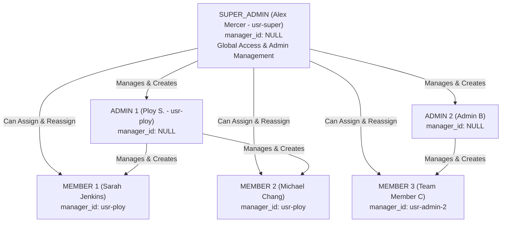

# Strategic CRM — Backend Integration Guide (Java / Spring Boot)

> **Document Status**: Production Handoff Specification  
> **Target Audience**: Backend Engineers (Java 17/21, Spring Boot 3.x, Spring Security 6.x, Spring Data JPA, PostgreSQL)  
> **Frontend Companion Document**: `docs/API_CONTRACT.md`  
> **Base URL**: `/api`  
> **Protocol**: HTTPS / RESTful JSON  

---

## Table of Contents
1. [Architectural Overview & RBAC Hierarchy](#1-architectural-overview--rbac-hierarchy)
2. [Database Schema & Migrations (PostgreSQL / Flyway / Liquibase)](#2-database-schema--migrations-postgresql--flyway--liquibase)
3. [Role-Scoped Data Filtering (Spring Data JPA Specifications)](#3-role-scoped-data-filtering-spring-data-jpa-specifications)
4. [User Management Endpoints & Business Logic](#4-user-management-endpoints--business-logic)
5. [Account Module Dependencies & History Notes](#5-account-module-dependencies--history-notes)
6. [Error Handling & HTTP 409 Conflict Specifications](#6-error-handling--http-409-conflict-specifications)
7. [Microsoft Entra ID (Azure AD) SSO Roadmap](#7-microsoft-entra-id-azure-ad-sso-roadmap)

---

## 1. Architectural Overview & RBAC Hierarchy

The Strategic CRM system implements a **three-tier strict hierarchical Role-Based Access Control (RBAC)** model. The legacy `VIEWER` role has been completely deprecated and removed.



### 1.1 The Three System Roles

| Role | Cardinality | Parent (`manager_id`) | Description & Operational Scope |
|---|---|---|---|
| `SUPER_ADMIN` | **Exactly 1** (e.g. `usr-super`) | `NULL` | Root authority. Manages all Admin and Member users. Can reassign Members across Admins. Cannot be deactivated or demoted via API. Has unrestricted visibility across all system accounts, contacts, and lookups. |
| `ADMIN` | Multiple | `NULL` | Departmental or regional lead. Manages **only their own assigned Members** (where `member.manager_id == currentAdmin.id`). Can create Members (auto-assigned to self). Has full account and lookup management privileges. |
| `MEMBER` | Multiple | **Required** (references an `ADMIN`) | Standard operational team member. Belongs to exactly one Admin. Can create accounts and log history notes. Has **no access** to `/api/users` (HTTP 403 Forbidden). |

---

## 2. Database Schema & Migrations (PostgreSQL / Flyway / Liquibase)

### 2.1 Flyway Migration Script: `V3__user_hierarchy_and_email_not_null.sql`

```sql
-- 1. Ensure email column is NOT NULL and UNIQUE (case-insensitive)
-- If legacy null emails exist, populate them with a placeholder before running:
UPDATE users SET email = LOWER(CONCAT(username, '@saga-consulting.com')) WHERE email IS NULL OR TRIM(email) = '';

ALTER TABLE users 
    ALTER COLUMN email SET NOT NULL,
    ADD CONSTRAINT uq_users_email_ci UNIQUE (email);

CREATE UNIQUE INDEX idx_users_email_lower ON users (LOWER(email));
CREATE UNIQUE INDEX idx_users_username_lower ON users (LOWER(username));

-- 2. Add manager_id foreign key referencing users(id)
ALTER TABLE users 
    ADD COLUMN manager_id VARCHAR(36) NULL,
    ADD CONSTRAINT fk_users_manager 
        FOREIGN KEY (manager_id) 
        REFERENCES users(id) 
        ON DELETE SET NULL;

CREATE INDEX idx_users_manager_id ON users (manager_id);

-- 3. Update Role Check Constraint: Allow only SUPER_ADMIN, ADMIN, MEMBER
-- Drop any existing check constraint on role:
ALTER TABLE users DROP CONSTRAINT IF EXISTS chk_users_role;

-- Migrate legacy VIEWER roles to MEMBER if any exist:
UPDATE users SET role = 'MEMBER' WHERE role = 'VIEWER';

ALTER TABLE users 
    ADD CONSTRAINT chk_users_role 
    CHECK (role IN ('SUPER_ADMIN', 'ADMIN', 'MEMBER'));

-- 4. Enforce exactly one SUPER_ADMIN at DB level:
CREATE UNIQUE INDEX idx_single_super_admin 
    ON users (role) 
    WHERE role = 'SUPER_ADMIN';

-- 5. Seed / Update Root Super Admin record:
INSERT INTO users (id, name, code, username, email, phone, role, status, manager_id, created_date, updated_date)
VALUES (
    'usr-super', 
    'Alex Mercer', 
    'AM', 
    'alex.mercer', 
    'alex.mercer@saga-consulting.com', 
    '+66 2 555 0100', 
    'SUPER_ADMIN', 
    'ACTIVE', 
    NULL, 
    NOW(), 
    NOW()
)
ON CONFLICT (id) DO UPDATE SET 
    role = 'SUPER_ADMIN',
    manager_id = NULL,
    email = 'alex.mercer@saga-consulting.com';

-- 6. Assign existing members under default Admin (usr-ploy):
UPDATE users 
SET manager_id = 'usr-ploy' 
WHERE role = 'MEMBER' AND manager_id IS NULL AND id <> 'usr-ploy' AND id <> 'usr-super';
```

### 2.2 JPA Entity Definition (`User.java`)

```java
package com.sagaconsulting.crm.user.entity;

import jakarta.persistence.*;
import jakarta.validation.constraints.Email;
import jakarta.validation.constraints.NotBlank;
import jakarta.validation.constraints.Size;
import lombok.Getter;
import lombok.Setter;
import java.time.Instant;

@Entity
@Table(name = "users")
@Getter
@Setter
public class User {

    @Id
    @Column(length = 36)
    private String id;

    @NotBlank
    @Size(max = 100)
    @Column(nullable = false, length = 100)
    private String name;

    @Size(max = 20)
    @Column(length = 20, unique = true)
    private String code;

    @NotBlank
    @Size(min = 3, max = 50)
    @Column(nullable = false, unique = true, length = 50)
    private String username;

    @NotBlank
    @Email
    @Size(max = 254)
    @Column(nullable = false, unique = true, length = 254)
    private String email;

    @Size(max = 20)
    @Column(length = 20)
    private String phone;

    @Column(name = "photo_url", length = 500)
    private String photoUrl;

    @Enumerated(EnumType.STRING)
    @Column(nullable = false, length = 20)
    private UserRole role; // SUPER_ADMIN, ADMIN, MEMBER

    @Enumerated(EnumType.STRING)
    @Column(nullable = false, length = 20)
    private UserStatus status; // ACTIVE, INACTIVE

    @ManyToOne(fetch = FetchType.LAZY)
    @JoinColumn(name = "manager_id")
    private User manager;

    @Column(name = "password_hash", nullable = false, length = 255)
    private String passwordHash;

    @Column(name = "created_date", nullable = false, updatable = false)
    private Instant createdDate;

    @Column(name = "updated_date", nullable = false)
    private Instant updatedDate;

    @PrePersist
    public void onPrePersist() {
        this.createdDate = Instant.now();
        this.updatedDate = Instant.now();
    }

    @PreUpdate
    public void onPreUpdate() {
        this.updatedDate = Instant.now();
    }
}
```

---

## 3. Role-Scoped Data Filtering (Spring Data JPA Specifications)

Security rules must be enforced **server-side**; never trust client-provided query filters alone.

### 4.1 User Query Scoping Specification

When querying `GET /api/users`:

```java
public class UserSpecifications {

    public static Specification<User> forCurrentActor(User currentActor, UserFilter filter) {
        return (root, query, cb) -> {
            List<Predicate> predicates = new ArrayList<>();

            // 1. Role Scoping
            if (currentActor.getRole() == UserRole.SUPER_ADMIN) {
                // Super Admin can see everyone.
                // If Super Admin specifically filters by managerId:
                if (filter.managerId() != null && !filter.managerId().isBlank()) {
                    predicates.add(cb.equal(root.get("manager").get("id"), filter.managerId()));
                }
            } else if (currentActor.getRole() == UserRole.ADMIN) {
                // Admin can see self PLUS members whose manager is currentAdmin
                Predicate isSelf = cb.equal(root.get("id"), currentActor.getId());
                Predicate isAssignedMember = cb.and(
                    cb.equal(root.get("role"), UserRole.MEMBER),
                    cb.equal(root.get("manager").get("id"), currentActor.getId())
                );
                predicates.add(cb.or(isSelf, isAssignedMember));
            } else {
                // Members cannot query users list
                throw new AccessDeniedException("Access denied. Members cannot list users.");
            }

            // 2. Keyword Filter (q across name, username, code)
            if (filter.q() != null && !filter.q().isBlank()) {
                String pattern = "%" + filter.q().trim().toLowerCase() + "%";
                Predicate nameMatch = cb.like(cb.lower(root.get("name")), pattern);
                Predicate usernameMatch = cb.like(cb.lower(root.get("username")), pattern);
                Predicate codeMatch = cb.like(cb.lower(root.get("code")), pattern);
                predicates.add(cb.or(nameMatch, usernameMatch, codeMatch));
            }

            // 3. Role Filter
            if (filter.role() != null) {
                predicates.add(cb.equal(root.get("role"), filter.role()));
            }

            // 4. Status Filter
            if (filter.status() != null) {
                predicates.add(cb.equal(root.get("status"), filter.status()));
            }

            return cb.and(predicates.toArray(new Predicate[0]));
        };
    }
}
```

---

## 4. User Management Endpoints & Business Logic

### 4.1 Endpoint Summary & Access Matrix

| HTTP Method | Path | Required Role | Description |
|---|---|---|---|
| `GET` | `/api/me` | Authenticated | Returns current profile, role, and manager info |
| `PUT` | `/api/me` | Authenticated | Updates own `name`, `email`, `phone` (email strictly required) |
| `GET` | `/api/users` | `SUPER_ADMIN`, `ADMIN` | Scoped list of users (Members get HTTP 403) |
| `GET` | `/api/users/options` | Authenticated | Active users for dropdowns (shows `id`, `name`, `code`, `photoUrl`) |
| `GET` | `/api/users/{id}` | `SUPER_ADMIN`, `ADMIN` | Detail view (Admins can view self or own members) |
| `POST` | `/api/users` | `SUPER_ADMIN`, `ADMIN` | Create user (Admins can create only `MEMBER`; Super Admin creates `ADMIN` or `MEMBER`) |
| `PUT` | `/api/users/{id}` | `SUPER_ADMIN`, `ADMIN` | Update user profile and role |
| `PATCH` | `/api/users/{id}/status` | `SUPER_ADMIN`, `ADMIN` | Quick toggle `ACTIVE` / `INACTIVE` |
| `POST` | `/api/users/{id}/reset-password` | `SUPER_ADMIN`, `ADMIN` | Reset password for a managed user |

### 4.2 Creation Logic (`POST /api/users`)

```java
@Transactional
public UserDTO createUser(User currentActor, CreateUserRequest req) {
    // 1. Role authorization
    if (currentActor.getRole() == UserRole.ADMIN) {
        if (req.role() != UserRole.MEMBER) {
            throw new AccessDeniedException("Admins can only create Member users.");
        }
    } else if (currentActor.getRole() != UserRole.SUPER_ADMIN) {
        throw new AccessDeniedException("Access denied.");
    }

    // 2. Uniqueness checks (409 Conflict)
    if (userRepository.existsByEmailIgnoreCase(req.email().trim())) {
        throw new BusinessConflictException("Email '" + req.email() + "' is already registered to another user.");
    }
    if (userRepository.existsByUsernameIgnoreCase(req.username().trim())) {
        throw new BusinessConflictException("Username '" + req.username() + "' is already taken.");
    }
    if (req.code() != null && !req.code().isBlank() && userRepository.existsByCodeIgnoreCase(req.code().trim())) {
        throw new BusinessConflictException("Initials Code '" + req.code() + "' is already in use.");
    }

    User user = new User();
    user.setId("usr-" + UUID.randomUUID().toString().substring(0, 8));
    user.setName(req.name().trim());
    user.setUsername(req.username().trim().toLowerCase());
    user.setEmail(req.email().trim().toLowerCase());
    user.setPhone(req.phone() != null ? req.phone().trim() : null);
    user.setCode(req.code() != null ? req.code().trim().toUpperCase() : null);
    user.setRole(req.role());
    user.setStatus(req.status() != null ? req.status() : UserStatus.ACTIVE);
    user.setPasswordHash(passwordEncoder.encode(req.password()));

    // 3. Manager Assignment Logic
    if (req.role() == UserRole.MEMBER) {
        if (currentActor.getRole() == UserRole.ADMIN) {
            // Admin is automatically the manager of created member
            user.setManager(currentActor);
        } else if (currentActor.getRole() == UserRole.SUPER_ADMIN) {
            // Super Admin must specify an active Admin as manager
            if (req.managerId() == null || req.managerId().isBlank()) {
                throw new BadRequestException("managerId is required when creating a Member as Super Admin.");
            }
            User assignedAdmin = userRepository.findByIdAndRoleAndStatus(req.managerId(), UserRole.ADMIN, UserStatus.ACTIVE)
                .orElseThrow(() -> new BadRequestException("Specified manager is not an active Admin."));
            user.setManager(assignedAdmin);
        }
    } else {
        // ADMIN users have manager = NULL
        user.setManager(null);
    }

    user = userRepository.save(user);
    return userMapper.toDTO(user);
}
```

---

## 5. Account Module Dependencies & History Notes

### 5.1 Category & Sub-Category Dependent Relationship
1. **Dependent Hierarchy**:
   - `subCategoryId` cannot be populated unless `categoryId` is provided.
   - The selected `subCategoryId` must exist within the parent `categoryId`.
2. **Backend Validation**:
   In `POST /api/accounts` and `PUT /api/accounts/{id}`:
   ```java
   if (req.subCategoryId() != null) {
       if (req.categoryId() == null) {
           throw new BadRequestException("subCategoryId cannot be specified without a valid categoryId.");
       }
       boolean validPair = subCategoryRepository.existsByIdAndCategoryId(req.subCategoryId(), req.categoryId());
       if (!validPair) {
           throw new BadRequestException("The specified sub-category does not belong to the selected category.");
       }
   }
   ```
3. **Query Sanitization**:
   In `GET /api/accounts`, if `subCategoryId` is present in the query string without `categoryId`, the backend must either ignore `subCategoryId` or return HTTP 400. The frontend automatically resets and removes `subCategoryId` whenever `categoryId` is cleared or changed.

### 5.2 History Notes vs. Activities
- Endpoint: `POST /api/accounts/{id}/notes`
- Semantics: Represents **historical logs of completed activities** (e.g. calls, meetings, follow-ups concluded in the past) rather than open or scheduled to-dos.
- The UI displays: **"Add History Note"** with a prompt to record summary, key outcomes, and decisions from past activities.

---

## 6. Error Handling & HTTP 409 Conflict Specifications

### 6.1 Conflict Rules (HTTP 409)

| Scenario | Condition | HTTP Status | Response Message |
|---|---|:---:|---|
| **Self-Deactivation** | Authenticated user attempts to deactivate their own account via `PUT` or `PATCH /status` | `409 Conflict` | `"You cannot deactivate your own active account."` |
| **Super Admin Protection** | Attempting to deactivate, delete, or change the role of the single `SUPER_ADMIN` | `409 Conflict` | `"The Super Admin account cannot be deactivated or demoted."` |
| **Duplicate Email** | Creating or updating user with an email already taken by another account | `409 Conflict` | `"Email '...' is already registered to another user."` |
| **Duplicate Username** | Creating or updating user with an existing username | `409 Conflict` | `"Username '...' is already taken."` |
| **Duplicate Code** | Creating or updating user with existing initials code | `409 Conflict` | `"Initials Code '...' is already in use."` |

### 6.2 Controller Advice Exception Handler

```java
@RestControllerAdvice
public class GlobalExceptionHandler {

    @ExceptionHandler(BusinessConflictException.class)
    public ResponseEntity<Map<String, Object>> handleConflict(BusinessConflictException ex) {
        return ResponseEntity.status(HttpStatus.CONFLICT).body(Map.of(
            "status", 409,
            "error", "Conflict",
            "message", ex.getMessage()
        ));
    }

    @ExceptionHandler(DataIntegrityViolationException.class)
    public ResponseEntity<Map<String, Object>> handleDataIntegrity(DataIntegrityViolationException ex) {
        String msg = "A database constraint violation occurred.";
        if (ex.getMessage() != null && ex.getMessage().contains("uq_users_email")) {
            msg = "This email address is already in use.";
        }
        return ResponseEntity.status(HttpStatus.CONFLICT).body(Map.of(
            "status", 409,
            "error", "Conflict",
            "message", msg
        ));
    }
}
```

---

## 7. Microsoft Entra ID (Azure AD) SSO Roadmap

To enable enterprise Single Sign-On (SSO) alongside database-backed authentication:

### 7.1 Dependencies (`pom.xml`)
```xml
<dependency>
    <groupId>org.springframework.boot</groupId>
    <artifactId>spring-boot-starter-oauth2-resource-server</artifactId>
</dependency>
```

### 7.2 `application.yml`
```yaml
spring:
  security:
    oauth2:
      resourceserver:
        jwt:
          issuer-uri: https://login.microsoftonline.com/${AZURE_TENANT_ID}/v2.0
          jwk-set-uri: https://login.microsoftonline.com/${AZURE_TENANT_ID}/discovery/v2.0/keys
```

### 7.3 JWT Authentication Converter
Map Entra ID Claims (`preferred_username`, `email`, `roles` or `groups`) to CRM roles:
```java
@Component
public class EntraIdJwtAuthenticationConverter implements Converter<Jwt, AbstractAuthenticationToken> {

    @Override
    public AbstractAuthenticationToken convert(Jwt jwt) {
        String email = jwt.getClaimAsString("preferred_username");
        // Lookup user by email in local database:
        User user = userRepository.findByEmailIgnoreCase(email)
            .orElseThrow(() -> new BadCredentialsException("No CRM account provisioned for SSO email: " + email));

        List<GrantedAuthority> authorities = List.of(
            new SimpleGrantedAuthority("ROLE_" + user.getRole().name())
        );

        return new JwtAuthenticationToken(jwt, authorities, user.getUsername());
    }
}
```

---

*This guide serves as the authoritative source of truth for the Java / Spring Boot implementation.*
